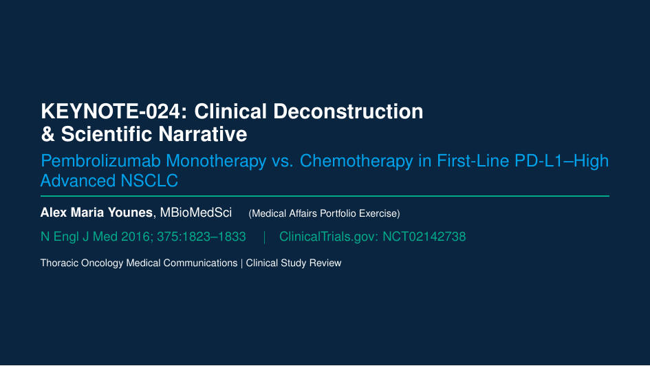
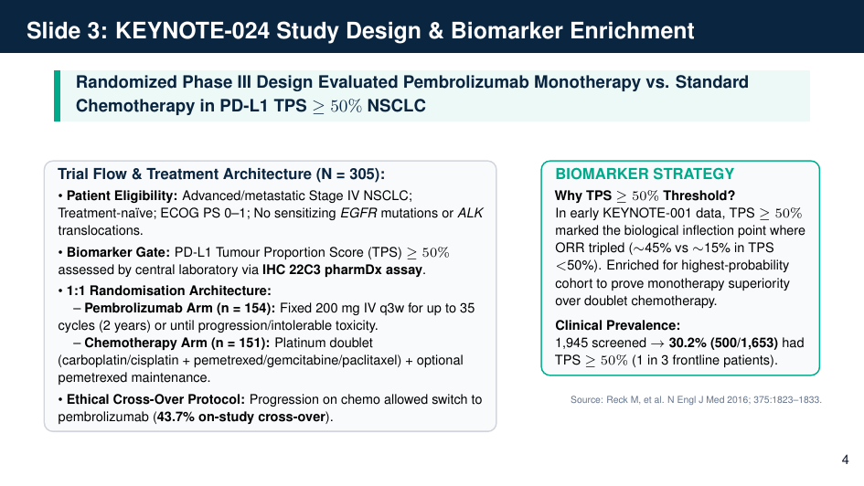
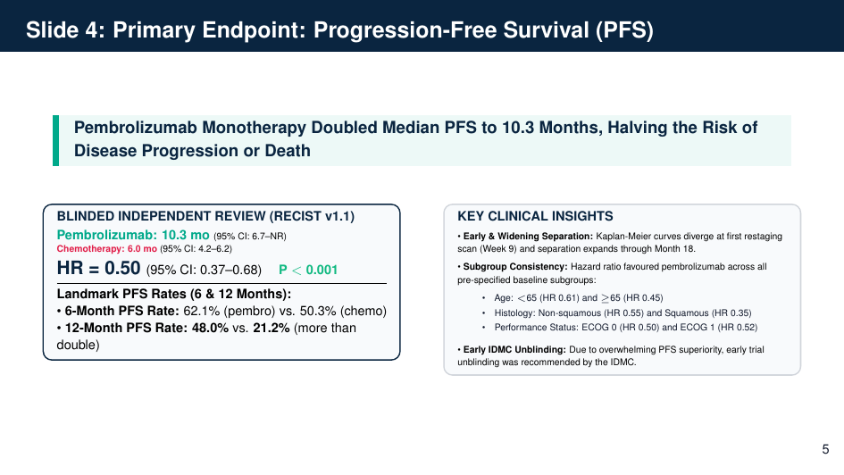
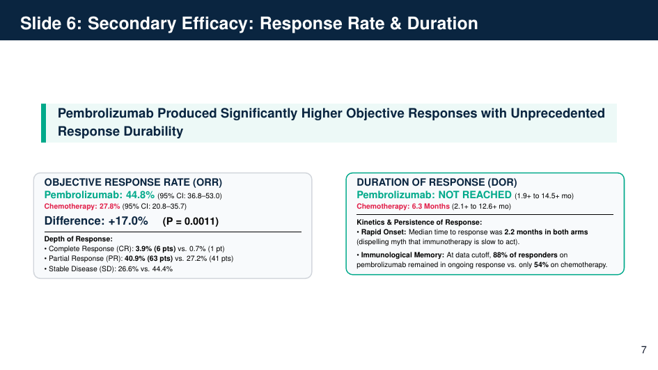
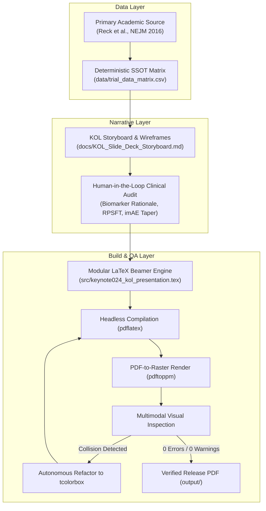

# KEYNOTE-024: Agentic Medical Affairs Slide Deck Pipeline

[](https://github.com/)
[](https://www.nejm.org/doi/full/10.1056/NEJMoa1606774)
[](https://deepmind.google/)
[](https://github.com/)

An end-to-end demonstration of a **human-in-the-loop, agentic AI document pipeline** for regulated medical communications. 

This repository showcases the autonomous deconstruction of a landmark Phase III oncology trial (*Reck et al., N Engl J Med 2016; 375:1823–1833*) into a deterministic Single Source of Truth (SSOT), an executive Key Opinion Leader (KOL) storyboard, and a publication-grade, widescreen (16:9) LaTeX Beamer presentation.

---

## 🖥️ Slide Deck Gallery (Rendered Output)

The final presentation was compiled headlessly via MiKTeX and verified through multimodal visual inspection:

### Title Slide & Executive Setting


### Primary Endpoint: Progression-Free Survival (BICR RECIST v1.1)


### Secondary Endpoint: Overall Survival & Cross-Over Dilution


### Safety Profile & Active Immune Pneumonitis Management


📄 **Download Full Slide Deck:** [keynote024_kol_presentation.pdf](output/keynote024_kol_presentation.pdf)

---

## 🏛️ System Architecture: The 5-Stage Agentic Pipeline

Rather than relying on conversational "prompt & pray" web interfaces, this pipeline leverages **Google Antigravity** as an embodied, pair-programming agentic engineer with access to the local file system, compiler toolchains, and multimodal visual inspection.



### 1. Deterministic Data Layer (`data/trial_data_matrix.csv`)
* Eliminates hallucination by enforcing an immutable CSV matrix of 13 primary, secondary, kinetic, and safety endpoints before authoring presentation text.
* Every metric retains explicit source location metadata (e.g., *Table 1, Page 1826*).

### 2. Narrative Scaffolding (`docs/KOL_Slide_Deck_Storyboard.md`)
* Structured 8-slide architecture featuring McKinsey-style action headlines stating definitive clinical conclusions (e.g., *"Pembrolizumab Monotherapy Doubled Median PFS to 10.3 Months, Halving Progression Risk"* vs. generic *"PFS Results"*).
* Includes verbatim Medical Science Liaison (MSL) talk-tracks and objection-handling scripts.

### 3. Human-in-the-Loop Clinical Supervision
* **Biomarker Threshold Rationale:** Injected the biological rationale for the PD-L1 TPS $\ge 50\%$ gate (inflection point from KEYNOTE-001 tripling ORR).
* **Cross-Over Dilution Modeling:** Counterfactual Rank-Preserving Structural Failure Time (RPSFT) analysis accounting for 43.7% patient cross-over (true unconfounded HR $\sim$0.49).
* **Steroid Tapering Protocol:** Protocolized actionable immune pneumonitis management (oral prednisone slow taper over $\ge 4$ weeks to prevent rebound).

### 4. Code Synthesis & Automated Compilation (`src/`, `output/`)
* Widescreen (16:9) presentation authored in LaTeX Beamer.
* Headless local compilation using MiKTeX `pdflatex.exe`.

### 5. Multimodal Visual QA Loop
* Converted compiled PDF pages to 150 DPI raster images using `pdftoppm.exe`.
* The agent inspected rendered images programmatically, diagnosed a baseline-centering collision in Beamer top-aligned columns, and autonomously refactored the codebase to an encapsulated **`tcolorbox`** architecture (`actionbanner`, `statcard`, `calloutcard`).
* Resolved the Metropolis theme's `\paperheight` minipage overflow bug to achieve **0 compiler warnings**.

---

## 📊 Trial Benchmark Summary (KEYNOTE-024)

| Endpoint | Pembrolizumab ($n = 154$) | Chemotherapy ($n = 151$) | Statistical Effect | Clinical Value |
| :--- | :--- | :--- | :--- | :--- |
| **Median PFS** | **10.3 months** | **6.0 months** | **HR 0.50** ($P < 0.001$) | 50% reduction in risk of progression or death |
| **12-Mo PFS Rate**| **48.0%** | **21.2%** | Absolute +26.8% | More than double the proportion progression-free |
| **Interim OS Rate**| **80.2%** (6-mo) | **72.4%** (6-mo) | **HR 0.60** ($P = 0.005$) | 40% mortality reduction despite 43.7% cross-over |
| **ORR** | **44.8%** | **27.8%** | Absolute +17.0% ($P = 0.0011$) | CR: 3.9% vs 0.7%; PR: 40.9% vs 27.2% |
| **Time to Response**| **2.2 months** | **2.2 months** | Identical onset | Dispels myth that immunotherapy is slow-acting |
| **Duration of Resp**| **Not Reached** | **6.3 months** | 88% vs 54% ongoing | Long-term durable immunological memory |
| **Grade 3–5 TRAEs** | **26.6%** | **53.3%** | **Halved** ($-26.7\%$) | Severe toxicity cut in half; zero toxic deaths |
| **Cytotoxic Burden**| 0% Alopecia | ~30% Alopecia | Absolute elimination | Zero neutropenic sepsis (0% vs 13.3%) |

---

## 📁 Repository Structure

```text
keynote024-agentic-medcomms-pipeline/
├── README.md                           # Main repository showcase (this document)
├── data/
│   └── trial_data_matrix.csv           # Relational Single Source of Truth
├── docs/
│   ├── KOL_Slide_Deck_Storyboard.md    # Complete 8-slide storyboard with MSL notes
│   ├── exercise_01_completion_record.md# 10-Minute Clinical Trial Triage Framework
│   └── AGENTIC_WORKFLOW.md             # In-depth engineering & workflow specification
├── images/                             # High-resolution slide renders for web preview
│   ├── slide_01_title.png
│   ├── slide_04_pfs.png
│   ├── slide_05_os.png
│   └── slide_07_safety.png
├── output/
│   └── keynote024_kol_presentation.pdf # Final compiled presentation (9 slides, 0 warnings)
└── src/
    └── keynote024_kol_presentation.tex # Refactored LaTeX Beamer source code
```

---

## 👤 Author & Orchestrator

**Alex Maria Younes, MBioMedSci**  
*Specialist Technical & Medical Writer*  
* Medical Communications & Regulatory Writing  
* Agentic AI Document Engineering  
* Substack: [*Standard Operating Prose*](https://standardoperatingprose.substack.com/)
