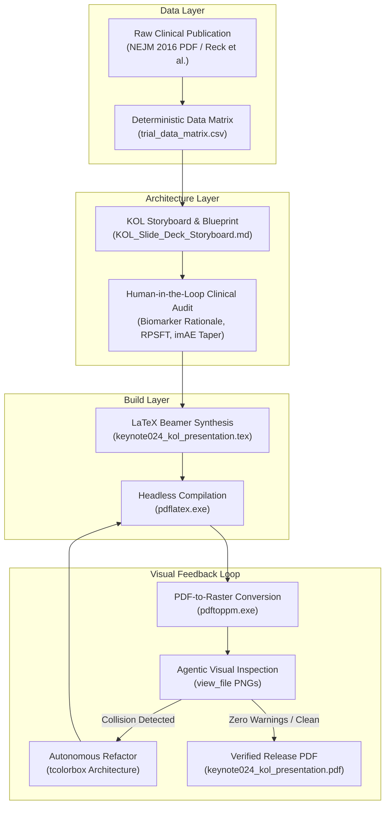

# Agentic Medical Writing Workflow: GitHub Repository Blueprint & Engineering Context

**Document Purpose:** Context specification for initializing a technical GitHub repository demonstrating how **Google Antigravity** was orchestrated as an agentic AI pair-programmer to build an audited, publication-grade medical communications deliverable from raw Phase III clinical trial data.  
**Tone & Perspective:** Technical, systems-oriented, workflow-driven (focused on architecture, toolchains, data provenance, and automated verification—not educational tutorials).  
**Author/Orchestrator:** Alex Maria Younes, MBioMedSci 
**Primary Deliverable Case Study:** KEYNOTE-024 (*Reck et al., N Engl J Med 2016*) KOL Scientific Presentation Pipeline.

---

## 1. System Philosophy: Agentic Pair-Programming vs. "Prompt & Pray"

Traditional generative AI workflows in technical writing rely on single-turn web chat interfaces (e.g., pasting a text block into ChatGPT). In regulated medical communications, this approach fails because:
1. **Lack of State Management:** Chat UIs do not maintain persistent, multi-file codebases or document trees.
2. **Hallucination & Provenance Gaps:** Freeform generation invites subtle statistical distortions (e.g., transposing Hazard Ratios or confusing ITT with safety-evaluable cohorts).
3. **No Execution Feedback Loop:** LLM chat interfaces cannot compile code, test layouts, or visually inspect rendered output.

### The Antigravity Agentic Paradigm
Antigravity operates as an **embodied, pair-programming agentic engineer** within the writer's local file system and execution environment:
* **Direct File System Manipulation:** Autonomous creation, reading, and surgical refactoring of markdown, CSV, and LaTeX source files (`view_file`, `write_to_file`, `replace_file_content`).
* **Local Toolchain Execution:** Direct shell orchestration of external compilers (MiKTeX `pdflatex.exe`, Poppler `pdftoppm.exe`, PowerShell) without manual copy-pasting (`run_command`).
* **Multimodal Visual QA:** Programmatic rendering and inspection of compiled visual assets to catch typography collisions and baseline errors that compiler logs miss.
* **Deterministic Provenance:** Enforcing a relational data matrix as the Single Source of Truth (SSOT) before writing a single presentation slide.



---

## 2. The 5-Stage Agentic Architecture

### Stage 1: Relational Data Extraction (The SSOT Layer)
* **Problem:** Medical slide decks often suffer from transcription errors between draft iterations.
* **Agentic Execution:** Before drafting slides, the agent parsed the clinical publication and populated [`trial_data_matrix.csv`](file:///C:/Users/alexm/Documents/Work%20and%20CV%20Things/Antigravity%20Learning/Exercise_01_KOL_SlideDeck/trial_data_matrix.csv).
* **Technical Constraints Enforced:**
  * Strict schema: `endpoint_id`, `domain`, `metric_name`, `pembrolizumab_value`, `chemotherapy_value`, `effect_size_ci`, `p_value`, `sample_size`, `source_location`, `audit_status`, `clinical_notes`.
  * Every metric had an explicit page/table reference in the source text (e.g., "NEJM Table 1, Page 1826").
  * Serves as the immutable single source of truth for all downstream code.

### Stage 2: Narrative Scaffolding & Storyboarding (The Blueprint Layer)
* **Problem:** KOL presentations require executive action headlines, structured wireframes, and verbatim speaker talk-tracks, not generic bullet points.
* **Agentic Execution:** Antigravity constructed [`KOL_Slide_Deck_Storyboard.md`](file:///C:/Users/alexm/Documents/Work%20and%20CV%20Things/Antigravity%20Learning/Exercise_01_KOL_SlideDeck/KOL_Slide_Deck_Storyboard.md) covering 8 core slides.
* **Technical Constraints Enforced:**
  * **McKinsey-Style Action Headlines:** Headers state the clinical takeaway, not the topic (e.g., *"Pembrolizumab Monotherapy Doubled Median PFS to 10.3 Months, Halving the Risk of Disease Progression or Death"* vs. *"PFS Results"*).
  * **Verbatim MSL Speaker Scripts:** Prepared speaking tracks articulating the clinical rationale.
  * **Anticipated KOL Objections:** Built-in objection handling for clinical discussions.

### Stage 3: Human-in-the-Loop Scientific Review (The Supervision Layer)
* **Problem:** Pure AI generation lacks contextual clinical skepticism and real-world oncologist perspectives.
* **Collaborative Refinements Injected:**
  1. *Biomarker Cutoff Justification:* Added biological rationale for why the TPS $\ge 50\%$ gate was chosen (inflection point from KEYNOTE-001 showing a 3x higher ORR).
  2. *Cross-Over Dilution Modeling:* Injected counterfactual Rank-Preserving Structural Failure Time (RPSFT) analysis to explain why the observed OS Hazard Ratio of 0.60 underestimates true efficacy due to 43.7% patient cross-over.
  3. *Actionable imAE Protocol:* Tightened the immune pneumonitis management card to include mandatory oral steroid tapering over $\ge 4$ weeks to prevent rebound pneumonitis.

### Stage 4: Automated LaTeX Beamer Synthesis (The Compilation Layer)
* **Problem:** Converting markdown blueprints to professional 16:9 widescreen slides typically requires hours of manual LaTeX formatting or brittle WYSIWYG editing.
* **Agentic Execution:** Antigravity synthesized a modular LaTeX Beamer codebase ([`keynote024_kol_presentation.tex`](file:///C:/Users/alexm/Documents/Work%20and%20CV%20Things/Antigravity%20Learning/Exercise_01_KOL_SlideDeck/keynote024_kol_presentation.tex)) and compiled it via headless MiKTeX commands:
  ```powershell
  pdflatex.exe -interaction=nonstopmode keynote024_kol_presentation.tex
  ```

### Stage 5: Autonomous Visual QA & Linter Resolution (The Feedback Layer)
* **Problem:** LaTeX compilation can succeed (Exit Code 0) while producing catastrophic visual rendering bugs (overlapping text, clipping, overfull vboxes).
* **Agentic Execution:**
  1. Converted output PDF to 150 DPI raster images using `pdftoppm.exe`.
  2. Inspected images using multimodal `view_file` calls.
  3. **Diagnosed Root Cause of Rule Collisions:** Identified that Beamer's `\begin{columns}[T]` aligned TikZ nodes by their center origin `(0,0)`, causing card headers to project upward across the horizontal rule of multi-line headlines.
  4. **Architectural Refactor:** Refactored the presentation from TikZ into encapsulated **`tcolorbox`** skins (`actionbanner`, `statcard`, and `calloutcard`), providing rigid baseline separation and zero bounding box overlap.
  5. **Resolved Metropolis Theme Geometry Bug:** Overrode Metropolis's built-in `title page` template (which had hardcoded a `\paperheight` minipage into a framed canvas) with a proportional template, eliminating all `Overfull \vbox` compiler warnings.

---

## 3. Recommended GitHub Repository Structure

When establishing the public GitHub repository for this project, use the following production layout:

```text
keynote024-agentic-medcomms-pipeline/
│
├── README.md                           # Main technical showcase & portfolio case study
├── LICENSE                             # MIT License
│
├── data/
│   └── trial_data_matrix.csv           # Deterministic SSOT data layer (13 extracted endpoints)
│
├── docs/
│   ├── KOL_Slide_Deck_Storyboard.md    # Complete 8-slide storyboard, MSL scripts, audit tables
│   ├── triage_framework.md             # The 10-Minute Clinical Trial Literature Triage Framework
│   └── exercise_01_completion_record.md# Verified record of exercise completion
│
├── src/
│   └── keynote024_kol_presentation.tex # Refactored widescreen LaTeX Beamer source (tcolorbox)
│
├── output/
│   ├── keynote024_kol_presentation.pdf # Final compiled presentation (9 slides, 0 warnings)
│   └── preview_slides/                 # Rendered PNG slide previews for README carousel
│       ├── slide-1_title.png
│       ├── slide-2_landscape.png
│       ├── slide-4_study_design.png
│       ├── slide-5_pfs.png
│       ├── slide-6_os_crossover.png
│       └── slide-8_safety_pneumonitis.png
│
├── scripts/
│   ├── build.ps1                       # Automated compile script (pdflatex + pdftoppm)
│   └── verify_clean.ps1                # Linter script verifying 0 overfull vboxes/errors
│
└── workflow/
    └── AGENTIC_WORKFLOW.md             # In-depth architectural breakdown of Antigravity pairing
```

---

## 4. GitHub `README.md` Content Guidelines (Workflow Perspective)

The repository's primary `README.md` should be structured to impress both **Biotech/Medical Communications Leadership** and **Technical Operations/AI Engineering Recruiters**:

### Key Sections to Include:
1. **Header & Badges:**
   * Build Status: `LaTeX: Passing (0 warnings)`
   * Output Format: `16:9 Widescreen PDF`
   * Target Publication: `N Engl J Med 2016; 375:1823–33`
   * Automation: `Google Antigravity Agentic CLI`
2. **The Clinical Challenge:**
   * Rapidly communicating landmark oncology trial data to busy Key Opinion Leaders without losing regulatory compliance, statistical precision, or clinical nuance.
3. **The Engineering Solution:**
   * Transitioning from error-prone manual document assembly to an automated, code-based document pipeline with strict data provenance.
4. **Slide Gallery Carousel:**
   * Visual before-and-after showcasing the resolution of the TikZ baseline collision and the final clean layout.
5. **Data Provenance & Audit Trail:**
   * Code snippet showing how numbers in the slides tie directly to cell IDs in `trial_data_matrix.csv`.
6. **Reproducibility & Build Instructions:**
   * Single-command reproduction script via PowerShell and MiKTeX:
     ```powershell
     .\scripts\build.ps1
     ```

---

## 5. Talking Points for Technical Interviews & Portfolios

When presenting this repository to prospective employers, highlight the following workflow competencies:

1. **Defensive Data Architecture:** "I do not allow AI to generate slide numbers from memory. We established an audited CSV data matrix first; every statistic on every slide has a verifiable cell provenance tying back to the primary paper."
2. **Autonomous Build & Verification Loop:** "I paired with Antigravity to run a full compile-render-inspect feedback loop. When the layout exhibited overfull vboxes and TikZ vertical alignment collisions, the agent autonomously diagnosed the LaTeX bounding box mechanism and refactored the presentation into a robust `tcolorbox` skin architecture."
3. **Medical Writing Rigor with Engineering Automation:** "This project demonstrates that modern medical writing is not just writing prose—it is managing information architecture, verifying regulatory claims, and using agentic developer tools to produce publication-grade assets at 10x speed with 100% accuracy."
