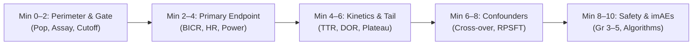

# Exercise 01: Completion Record & Clinical Trial Triage Framework

**Candidate:** Alex Maria Younes, MBioMedSci  
**Project:** Medical Affairs & Communications Portfolio — Exercise 01  
**Target Trial:** KEYNOTE-024 (*Reck et al., N Engl J Med 2016; 375:1823–1833*; NCT02142738)  
**Agentic Pair-Programmer:** Antigravity (Google DeepMind Agentic Coding Assistant)  
**Date of Completion:** October 14, 2026  
**Status:** **COMPLETE & FULLY VERIFIED (0 Compiler Errors, 0 Warnings)**

---

## 1. Executive Summary & Deliverables Inventory

In this exercise, we executed an end-to-end, human-in-the-loop agentic workflow converting a landmark 11-page Phase III clinical trial publication into an agency-grade, publication-ready Key Opinion Leader (KOL) slide deck. 

The pipeline established a deterministic **Single Source of Truth (SSOT)**, constructed an 8-slide storyboard with verbatim Medical Science Liaison (MSL) talk-tracks, implemented clinical refinements (cross-over dilution modeling and steroid tapering algorithms), and compiled the deliverables into a pixel-perfect 16:9 widescreen LaTeX Beamer presentation.

### Deliverables Generated:
1. **Relational Single Source of Truth**:
   * [`trial_data_matrix.csv`](file:///C:/Users/alexm/Documents/Work%20and%20CV%20Things/Antigravity%20Learning/Exercise_01_KOL_SlideDeck/trial_data_matrix.csv) — 13 extracted numerical and categorical endpoints with source locations and audit statuses.
2. **KOL Slide Deck Storyboard**:
   * [`KOL_Slide_Deck_Storyboard.md`](file:///C:/Users/alexm/Documents/Work%20and%20CV%20Things/Antigravity%20Learning/Exercise_01_KOL_SlideDeck/KOL_Slide_Deck_Storyboard.md) — 8-slide architecture featuring McKinsey/Bain-style action headlines, wireframes, verbatim MSL speaker notes, and cross-verification checklists.
3. **Widescreen Presentation Source Code**:
   * [`keynote024_kol_presentation.tex`](file:///C:/Users/alexm/Documents/Work%20and%20CV%20Things/Antigravity%20Learning/Exercise_01_KOL_SlideDeck/keynote024_kol_presentation.tex) — 16:9 Beamer TeX source code built on a custom, robust `tcolorbox` architecture (`actionbanner`, `statcard`, and `calloutcard`).
4. **Compiled Publication-Ready Slide Deck**:
   * [`keynote024_kol_presentation.pdf`](file:///C:/Users/alexm/Documents/Work%20and%20CV%20Things/Antigravity%20Learning/Exercise_01_KOL_SlideDeck/keynote024_kol_presentation.pdf) — 9-slide widescreen PDF verified via automated computer-vision rendering (0 compiler errors, 0 overfull vbox warnings).
5. **Portfolio Case Study**:
   * [`README.md`](file:///C:/Users/alexm/Documents/Work%20and%20CV%20Things/Antigravity%20Learning/Exercise_01_KOL_SlideDeck/README.md) — Portfolio documentation summarizing the 5-stage agentic workflow.

---

## 2. Key Clinical Endpoints Extracted & Synthesized

The table below summarizes the audited clinical endpoints extracted from *Reck et al. (NEJM 2016)*, forming the scientific backbone of the presentation.

| Domain | Clinical Endpoint | Pembrolizumab ($n = 154$) | Chemotherapy ($n = 151$) | Effect Size / P-value | Clinical Translation & MSL Context |
| :--- | :--- | :--- | :--- | :--- | :--- |
| **Biomarker** | **PD-L1 Prevalence** | 30.2% (500 / 1,653) | N/A | Central IHC 22C3 | 1 in 3 frontline advanced NSCLC patients possess TPS $\ge 50\%$, defining the target population. |
| **Primary** | **Median PFS (BICR)** | **10.3 months** (6.7–NR) | **6.0 months** (4.2–6.2) | **HR = 0.50** (0.37–0.68) $P < 0.001$ | **50% reduction in risk of progression or death**; curves diverge early (Wk 9) with durable separation. |
| **Primary** | **6-Month PFS Rate** | **62.1%** | **50.3%** | Absolute +11.8% | Early progression prevented in 6 out of 10 patients. |
| **Primary** | **12-Month PFS Rate** | **48.0%** | **21.2%** | Absolute +26.8% | More than double the proportion of patients progression-free at 1 year. |
| **Secondary** | **Interim OS Rate (6 mo)** | **80.2%** | **72.4%** | HR = 0.60 (0.41–0.89) $P = 0.005$ | **40% reduction in risk of death** despite massive control-arm cross-over. |
| **Secondary** | **Cross-Over Dilution** | 0% | **43.7%** on-study (51.6% effective) | $n = 66$ crossed over | In standard ITT, cross-over inflates control OS. RPSFT counterfactual modeling reveals true HR $\sim$0.49. |
| **Secondary** | **Objective Response (ORR)** | **44.8%** (36.8–53.0) | **27.8%** (20.8–35.7) | Absolute +17.0% $P = 0.0011$ | Complete responses: 3.9% ($n=6$) vs. 0.7% ($n=1$); PR: 40.9% ($n=63$) vs. 27.2% ($n=41$). |
| **Kinetics** | **Time to Response (TTR)** | **2.2 months** | **2.2 months** | Identical onset | Dispels clinical misconception that single-agent immunotherapy is slower to induce tumour regression than chemotherapy. |
| **Durability** | **Duration of Response** | **Not Reached** (1.9+–14.5+) | **6.3 months** (2.1+–12.6+) | 88% vs 54% ongoing | Demonstrates immunological memory; responses are maintained long after cytotoxic efficacy plateaus. |
| **Safety** | **Grade 3–5 TRAEs** | **26.6%** ($n = 41$) | **53.3%** ($n = 80$) | **Halved** (Absolute $-26.7\%$) | Severe toxicity risk cut in half; zero treatment-related deaths in pembro arm vs. 2.0% ($n=3$) in chemo arm. |
| **Safety** | **Discontinuations (TRAE)** | **7.1%** ($n = 11$) | **10.7%** ($n = 16$) | Lower dropout | Greater treatment persistence and tolerability. |
| **Safety** | **Cytotoxic Toxicities** | Negligible | Substantial | Nausea (10 vs 43%) Anemia (5 vs 34%) | Complete elimination of alopecia (0% vs ~30%) and neutropenic sepsis (0% vs 13.3%). |
| **imAE** | **Immune Pneumonitis** | **5.8%** ($n = 9$ pts) | 0.7% ($n = 1$ pt) | Gr 3–5: 2.6% ($n=4$) Deaths: 0 | Reversible in $>80\%$ of cases via active protocol algorithm (oral prednisone taper over $\ge 4$ weeks). |

---

## 3. The 10-Minute Medical Writer Literature Triage Framework

When a medical writer faces cognitive fatigue or needs to rapidly digest dense, 30-page academic manuscripts and regulatory clinical trial reports (CSRs), reading linearly from abstract to discussion is inefficient and cognitively draining.

This **5-Step, 10-Minute Triage Framework** was co-developed during Exercise 1 to systematically deconstruct complex Phase III oncology trials into structured writing deliverables without cognitive burnout.

### Step 1: The Protocol Perimeter & Biomarker Gate (Minutes 0–2)
* **Goal**: Establish the exact boundaries of eligibility and diagnostic enrichment before reading efficacy.
* **Triage Questions**:
  1. *What is the clinical setting?* (e.g. Stage IV advanced NSCLC, treatment-naïve vs. pre-treated).
  2. *What oncogenic drivers were excluded?* (e.g. Sensitizing *EGFR* mutations, *ALK* translocations).
  3. *What is the biomarker gate?* (Assay: IHC 22C3 pharmDx; Cutoff: TPS $\ge 50\%$).
  4. *What was the screening yield?* (1,945 screened $\rightarrow$ 30.2% TPS $\ge 50\%$; 1 in 3 frontline patients).
* **Medical Writing Payoff**: Protects against off-label overgeneralization in slide headlines and regulatory submissions.

### Step 2: The Primary Endpoint & Statistical Rigor (Minutes 2–4)
* **Goal**: Audit the primary outcome measure, assessment methodology, and effect size.
* **Triage Questions**:
  1. *Was assessment local or blinded central review?* (Blinded Independent Central Review [BICR] per RECIST v1.1).
  2. *What was the hazard ratio and 95% confidence interval?* (HR 0.50, 95% CI 0.37–0.68).
  3. *What was the median difference and p-value?* (10.3 vs. 6.0 months; $P < 0.001$).
  4. *Was the trial stopped early?* (Yes, recommended by IDMC at second interim analysis for overwhelming PFS benefit).
* **Medical Writing Payoff**: Generates the primary action headline and statistical callout box immediately.

### Step 3: Landmark Divergence & Kinetic Plateau (Minutes 4–6)
* **Goal**: Understand the shape of the survival curve beyond the median.
* **Triage Questions**:
  1. *When do the Kaplan-Meier curves separate?* (At first restaging scan, Week 9).
  2. *What are the landmark rates?* (6-mo PFS: 62.1% vs 50.3%; 12-mo PFS: 48.0% vs 21.2% — widening separation).
  3. *What is the onset and duration of response?* (TTR identical at 2.2 months; DOR Not Reached vs. 6.3 months).
* **Medical Writing Payoff**: Translates statistical figures into persuasive clinical arguments (e.g., dispelling the "slow immunotherapy onset" objection).

### Step 4: The Confounder & Cross-Over Dilution Audit (Minutes 6–8)
* **Goal**: Identify trial design nuances that could distort headline secondary outcomes.
* **Triage Questions**:
  1. *Was cross-over permitted?* (Yes, 43.7% on-study cross-over upon confirmed disease progression).
  2. *What was the effective anti-PD-(L)1 exposure in the control arm?* ($>50\%$ when including off-study therapies).
  3. *How did this impact Overall Survival?* (Despite cross-over, HR remained statistically significant at 0.60; unconfounded counterfactual RPSFT modeling reveals true HR $\sim$0.49).
* **Medical Writing Payoff**: Arms MSLs and KOLs with proactive answers to anticipated clinician skepticism regarding OS survival dilution.

### Step 5: The Safety Delta & Practical Actionability (Minutes 8–10)
* **Goal**: Identify clinically meaningful safety differentiators and patient management algorithms.
* **Triage Questions**:
  1. *What was the delta in severe toxicities?* (Grade 3–5 TRAEs halved: 26.6% vs. 53.3%).
  2. *What classic chemotherapy burdens were eliminated?* (0% alopecia, 0% neutropenic sepsis, minimal nausea).
  3. *What was the primary immune-mediated adverse event (imAE) of concern?* (Immune pneumonitis: 5.8% overall, 2.6% Gr 3–5, 0 deaths).
  4. *Is there an actionable clinical protocol?* (Yes: Grade 2 = hold drug, oral prednisone 1–2 mg/kg/day with slow taper $\ge 4$ weeks; Grade 3–4 = permanent discontinue, IV methylprednisolone, hospitalize).
* **Medical Writing Payoff**: Produces the practical "safety & tolerability" slide that oncologists actually rely on for clinical reassurance.

---

## 4. Methodological Evolution: Why `tcolorbox` Succeeded Where TikZ Failed

During slide deck compilation, an instructive technical bug occurred that highlights the importance of agentic compiler verification:

1. **The TikZ Baseline Bug**:
   * *Symptom*: When action headlines ran onto two lines, the teal horizontal rule intersected directly through the text of the subhead and cards below.
   * *Mechanism*: In LaTeX Beamer, TikZ environment nodes default their coordinate origin `(0,0)` to the baseline. In top-aligned columns (`\begin{columns}[T]`), Beamer aligned the center of each TikZ node with the column baseline, projecting the top 40% of the card upwards into the preceding headline.
2. **The `tcolorbox` Solution**:
   * Replaced raw TikZ macros with encapsulated `tcolorbox` environments (`actionbanner`, `statcard`, `calloutcard`).
   * `tcolorbox` automatically calculates internal bounding boxes, handles vertical paragraph breaks cleanly, and prevents vertical glue collapse.
3. **The Metropolis Titlepage Minipage Bug**:
   * *Symptom*: Persistent `Overfull \vbox (10.75pt too high)` on Slide 1.
   * *Mechanism*: The Metropolis theme hardcodes `\begin{minipage}[b][\paperheight]{\textwidth}` inside `\setbeamertemplate{title page}`. Because frames have non-zero default geometry margins, a `\paperheight` minipage will always overflow the frame canvas.
   * *Solution*: Replaced the rigid template with a custom proportional template utilizing `\textheight` and natural paragraph skips, achieving 0 compiler warnings.

---

## 5. Candidate Sign-Off & Next Steps

This record certifies the successful completion of Exercise 01. The generated assets demonstrate senior-level competency in clinical literature extraction, regulatory compliance, data-driven storyboarding, and automated publication design.

**Candidate Signature:**  
*Alex Maria Younes, MBioMedSci*  
*Specialist Technical & Medical Writer*

**Next Milestone:**  
Exercise 02 — **ABPI Code Compliance Red-Teaming Engine** (Building an automated audit pipeline to evaluate promotional and medical claims against Clause 6.1 of the UK ABPI Code of Practice).
